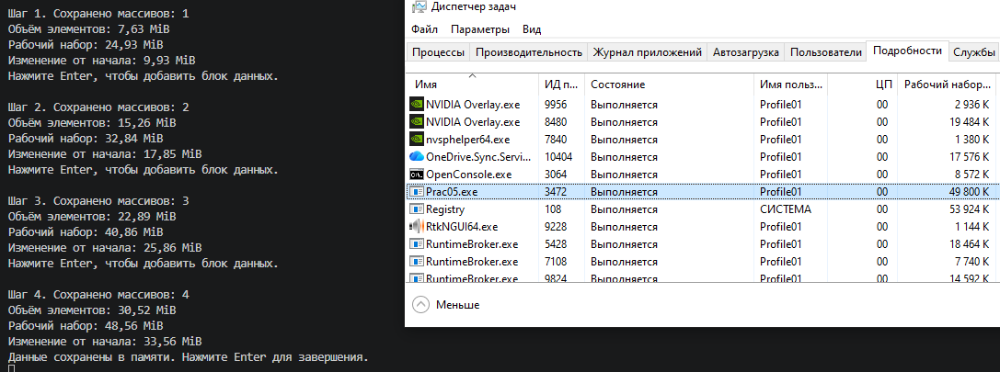
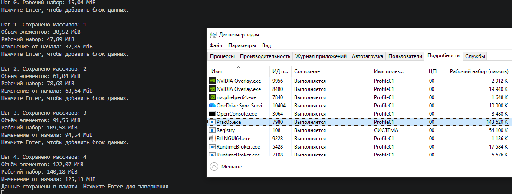

# Практическая работа №5
## Автор
ФИО: Острецов Владимир Павлович

Группа: ПМБИ-261
## Цель работы
Исследовать, как накопление данных влияет на использование оперативной
памяти, и сравнить расчётный размер данных с измеренной памятью процесса.
## Условия наблюдения
Столбец памяти в Диспетчере задач: Рабочий набор(память)

Единица показаний этого столбца: 1K

## Эксперимент 1. Накопление массивов byte

Расчёт для одного шага с подстановкой чисел: Количество массивов × элементов в массиве × байт на элемент

Байт на элемент = 1 байт

В MiB: 1 / 1 048 576 = 1 байт

| Шаг | Сохранено массивов | Расчётный объём элементов, MiB | Рабочий набор, Mib | изменения от начала, MiB |
| --: | -----------------: | -----------------------------: | -----------------: | -----------------------: |
|   0 |                  0 |                              0 |                 15 |                        0 |
|   1 |                  1 |                           7,63 |              24,93 |                     9,93 |
|   2 |                  2 |                          15,26 |              32,84 |                    17,85 |
|   3 |                  3 |                          22,89 |              40,86 |                    25,86 |
|   4 |                  4 |                          30,52 |              48,56 |                    33,56 |

Память в Диспетчере задач до добавления блоков: 4,9 Гб

Память в Диспетчере задач после четвёртого шага: 5,1 Гб

С добавлением массивов росла нагрузка на память, что происходило из-за того что массивы хранят в себе данные и для их хранения нужно место в памяти.

## Эксперимент 2. Накопление массивов int

| Шаг | Сохранено массивов | Расчётный объём элементов, MiB | Рабочий набор, Mib | изменения от начала, MiB |
| --: | -----------------: | -----------------------------: | -----------------: | -----------------------: |
|   0 |                  0 |                              0 |                  0 |                        0 |
|   1 |                  1 |                                |                    |                          |
|   2 |                  2 |                                |                    |                          |
|   3 |                  3 |                                |                    |                          |
|   4 |                  4 |                                |                    |                          |

